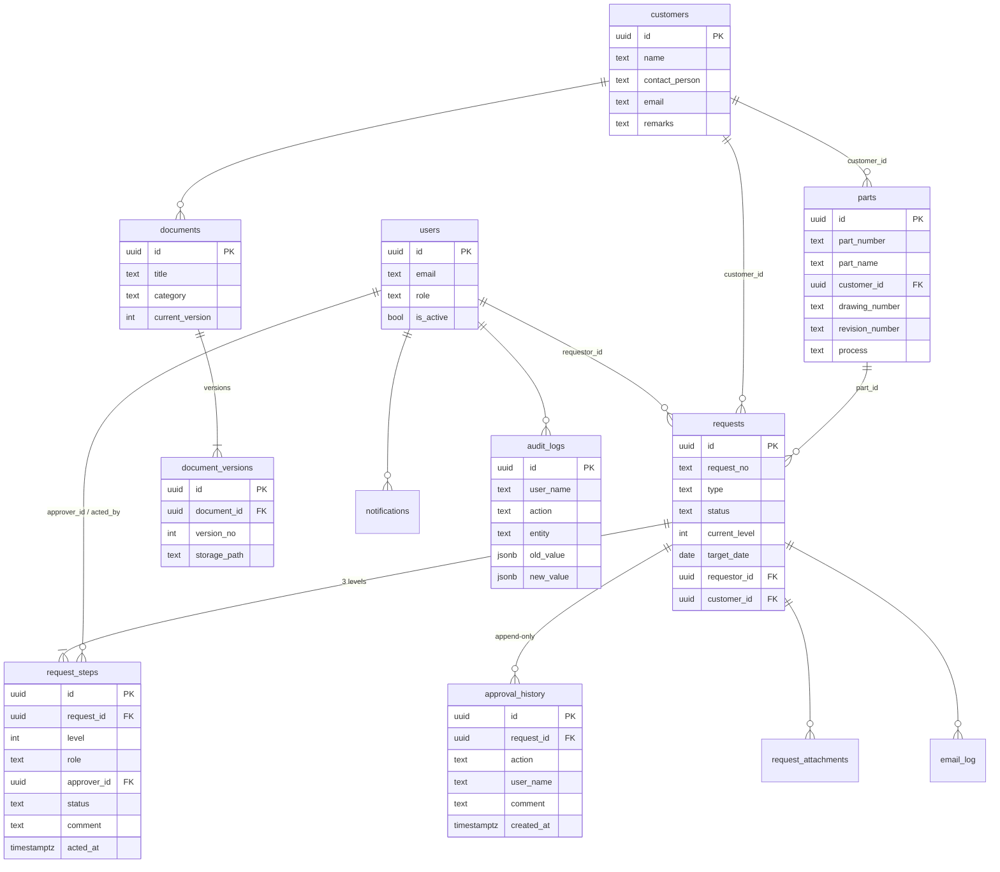

# QAMS: Quality & Engineering Approval Management System

Web app for managing PPAP, sample, packaging, engineering-change and other approval requests with a
3-level sequential approval workflow, email notifications, AI assistant (Google Gemini), document
repository, audit trail and reports.

**Stack:** HTML5 / CSS3 / Bootstrap 5 / vanilla JS (frontend) · Node.js + Express (API) · Supabase PostgreSQL + Storage ·
JWT email/password auth with role-based access · nodemailer (SMTP) · Google Gemini API · Vercel hosting.

---------------------------------------------------------------------

## 1. Folder structure

```
qams/
├── api/index.js              Vercel serverless entry (exports the Express app)
├── public/                   Static frontend (served by Vercel CDN / Express locally)
│   ├── index.html            Login page
│   ├── app.html              Application shell (sidebar, top bar, bell, dark mode)
│   ├── css/app.css           Theme (#0F4C81 / #1ABC9C / #F5F7FA, dark mode)
│   └── js/
│       ├── theme.js, api.js, ui.js, app.js (router), login.js
│       └── pages/            dashboard, requests, ai, masters (customers+parts),
│                             documents, reports, admin (users + audit)
├── src/
│   ├── app.js, server.js     Express app / local server
│   ├── config/supabase.js    Supabase service-role client
│   ├── middleware/           auth.js (JWT + RBAC), helpers.js (errors, validation)
│   ├── services/
│   │   ├── workflow.js       Sequential approval engine
│   │   ├── mailer.js         SMTP + HTML templates + in-app notifications
│   │   ├── gemini.js         Gemini client + prompts
│   │   └── audit.js          Audit trail writer
│   └── routes/               auth, users, customers, parts, requests, documents,
│                             ai, dashboard, reports, audit, notifications, cron
├── supabase/schema.sql       Full database schema + seed customers + storage bucket
├── scripts/seed-admin.js     Creates the first administrator
├── vercel.json, package.json, .env.example
```

## 2. Database design (ERD)



Full DDL with constraints, indexes, triggers (auto request numbers `REQ-2026-00001`, `updated_at`) and RLS
is in `supabase/schema.sql`.

## 3. Approval workflow

```
Requestor creates (Pending) -> Submit -> For Approval
  Level 1 Engineer --approve--> Level 2 Supervisor --approve--> Level 3 QA Manager --approve--> Approved -> Completed
  Any level: Reject (terminal) | Return for revision (-> Returned; requestor edits and resubmits from Level 1)
```

* Each approval step can have a **named approver**, otherwise **any active user with that role** may act.
* Emails go automatically: request created → approver 1 → (on approval) approver 2 → approver 3 → final notice.
* Reject / Return require a comment. Requestors cannot approve their own requests.
* Every action is time-stamped in `approval_history` (electronic approval history) and `audit_logs`.
* Concurrency-safe: a step is claimed with a conditional update, so double clicks cannot double-approve.

### Role permissions

| Capability | Requestor | Engineer | Supervisor | QA Manager | Admin |
|---|:-:|:-:|:-:|:-:|:-:|
| Create / edit own requests | ✔ | ✔ | ✔ | ✔ | ✔ |
| See all requests | own only | ✔ | ✔ | ✔ | ✔ |
| Approve at their level | | L1 | L2 | L3 | any |
| Customers add/edit | | ✔ | | ✔ | ✔ |
| Parts add/edit | | ✔ | ✔ | ✔ | ✔ |
| Delete master data / documents | | | | ✔ | ✔ |
| Reports | | ✔ | ✔ | ✔ | ✔ |
| Audit trail | | | | ✔ | ✔ |
| User management | | | | | ✔ |

## 4. Local setup

1. **Node 18+** installed.
2. **Supabase:** create a project at supabase.com → *SQL Editor* → paste and run `supabase/schema.sql`.
   (This also creates the private storage bucket `qams-files`.)
   Copy *Project URL* and the **service_role** key (Settings → API).
3. **Gemini key:** create a free key at https://aistudio.google.com/apikey.
4. **SMTP:** for Gmail enable 2-step verification and create an *App Password*; or use any SMTP provider.
   If SMTP is not configured the app still works, and emails are logged as "skipped" in `email_log`.
5. Configure and run:
   ```bash
   cd qams
   npm install
   cp .env.example .env          # then edit .env (use a long random JWT_SECRET and CRON_SECRET)
   npm run seed:admin -- admin@yourcompany.com "Admin Name" "StrongPassword123"
   npm run dev                   # http://localhost:3000
   ```
6. Sign in as the admin → **Users** → create Engineer, Supervisor, QA Manager and Requestor accounts.
   Add your parts under **Parts** (customers are pre-seeded).

Generate secrets: `node -e "console.log(require('crypto').randomBytes(48).toString('hex'))"`

## 5. Deployment (Vercel + Supabase)

The repo is already configured: `vercel.json` serves `public/` as static files, routes `/api/*` to the Express
function in `api/index.js`, and runs a **daily cron at 01:00 UTC** (`/api/cron/reminders`) for due-date reminders.

1. Push the project to GitHub.
2. Vercel → *Add New Project* → import the repo (Framework preset: *Other*; no build command).
3. *Settings → Environment Variables*: add every variable from `.env.example`
   (`APP_URL` = your Vercel URL, e.g. `https://qams.vercel.app`; `NODE_ENV=production`).
4. Deploy. Open the URL and sign in with the admin created via `seed:admin` (run it locally against the same
   Supabase project).
5. Vercel Cron automatically sends `Authorization: Bearer $CRON_SECRET` to the reminder endpoint, which is why
   `CRON_SECRET` must be set. Test manually:
   `curl -H "Authorization: Bearer <CRON_SECRET>" https://<your-app>/api/cron/reminders`

**Free-tier notes**
* Vercel Hobby cron runs once per day (matches the schedule used here).
* Vercel functions limit request bodies to ~4.5 MB, so uploads are capped at 4 MB per file.
  For larger files, upload directly from the browser to Supabase Storage with signed upload URLs.
* Gemini free tier is rate limited; the app caps each user to 10 AI calls/minute and shows a friendly message on 429.
* Supabase free projects pause after a week of inactivity.

## 6. Security checklist (already implemented)

* Passwords hashed with bcrypt (cost 12); JWT sessions (default 8 h), user re-checked on each request so disabled
  accounts lose access immediately.
* Role checks enforced on the server for every route; requestors can only read their own requests.
* `helmet` headers + strict CSP, login and API rate limiting, field whitelisting (no mass assignment).
* RLS enabled on all tables; the service-role key exists only on the server.
* Files stored in a **private** bucket and served through 2-minute signed URLs.
* Audit trail with old/new values for create/update/delete/approval/login/download actions.

Before going live: rotate all keys, use a custom domain with HTTPS, restrict `CORS_ORIGIN`, and review who has the
Administrator role.

## 7. API overview

| Area | Endpoints |
|---|---|
| Auth | `POST /api/auth/login`, `GET /api/auth/me`, `POST /api/auth/change-password` |
| Requests | `GET/POST /api/requests`, `GET/PUT /api/requests/:id`, `POST …/submit`, `POST …/action` (approve/reject/return), `POST …/complete`, `POST …/comment`, attachments |
| Master data | `/api/customers`, `/api/parts` (CRUD), `/api/users` (admin) |
| Documents | `GET/POST /api/documents`, `POST …/:id/versions`, `GET …/versions/:vid/url` |
| AI | `POST /api/ai/{email,grammar,rephrase,capa,minutes,inspection}` |
| Insight | `GET /api/dashboard`, `GET /api/reports/{status,leadtime,customer,monthly}?format=json|xlsx|pdf`, `GET /api/audit` |
| System | `GET /api/notifications`, `GET /api/cron/reminders` (secret) |

## 8. Extending

* **New request type:** add it to `TYPES` in `src/routes/requests.js`, the `CHECK` in `schema.sql`, and `REQ_TYPES` in `public/js/ui.js`.
* **Different approval route:** edit `ROUTE` in `src/services/workflow.js` (and the level/role checks in the schema).
* **New AI tool:** add a prompt in `src/services/gemini.js`, a route in `src/routes/ai.js`, and a form in `public/js/pages/ai.js`.
